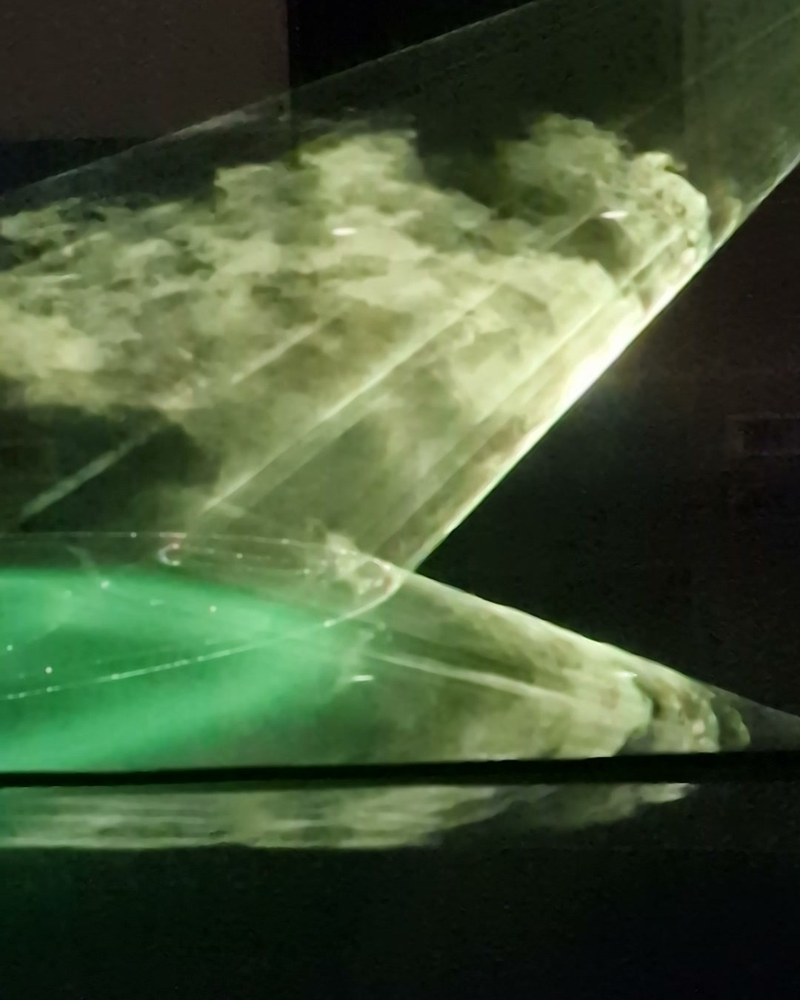
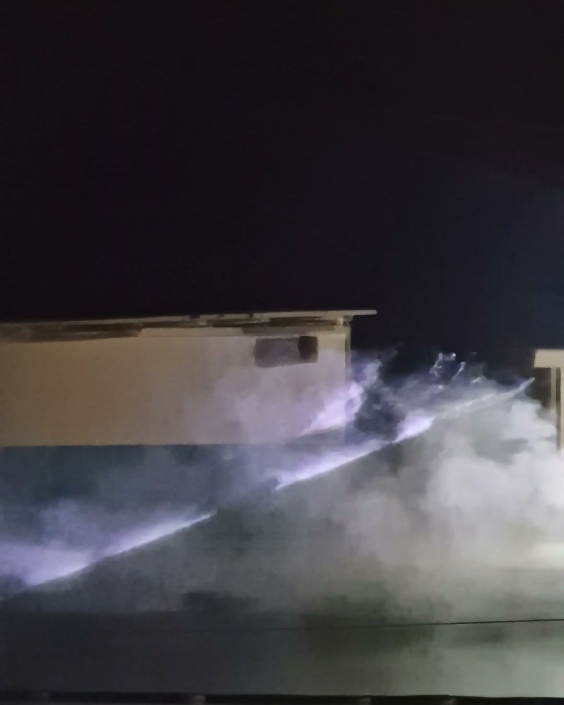
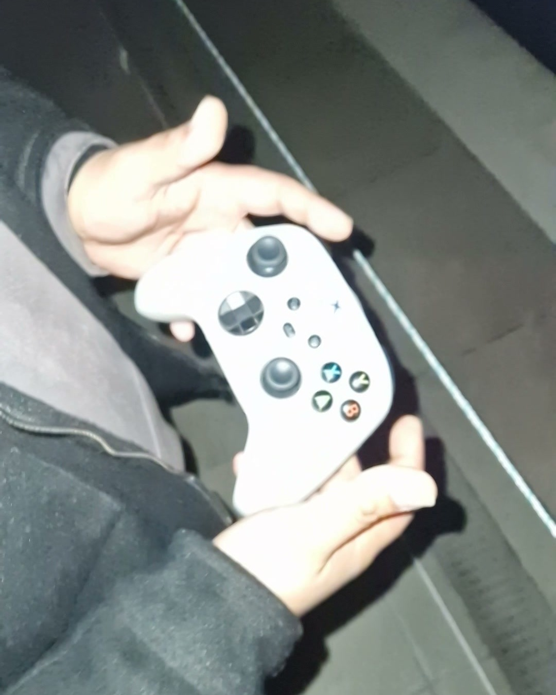
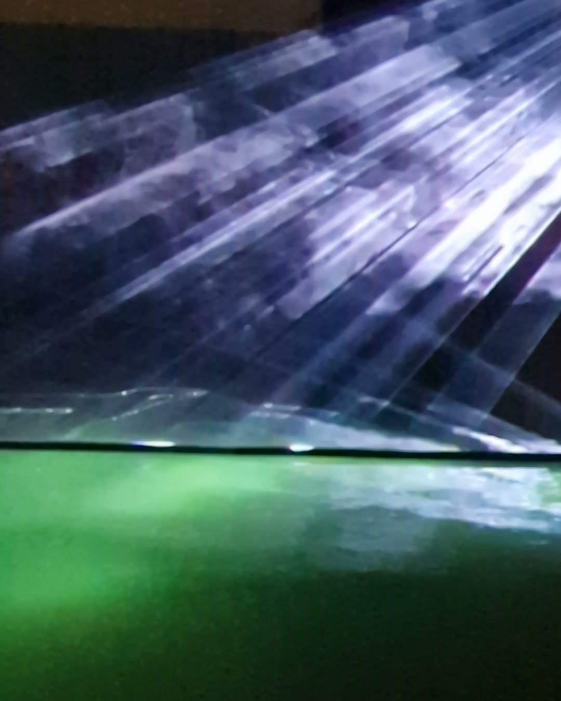
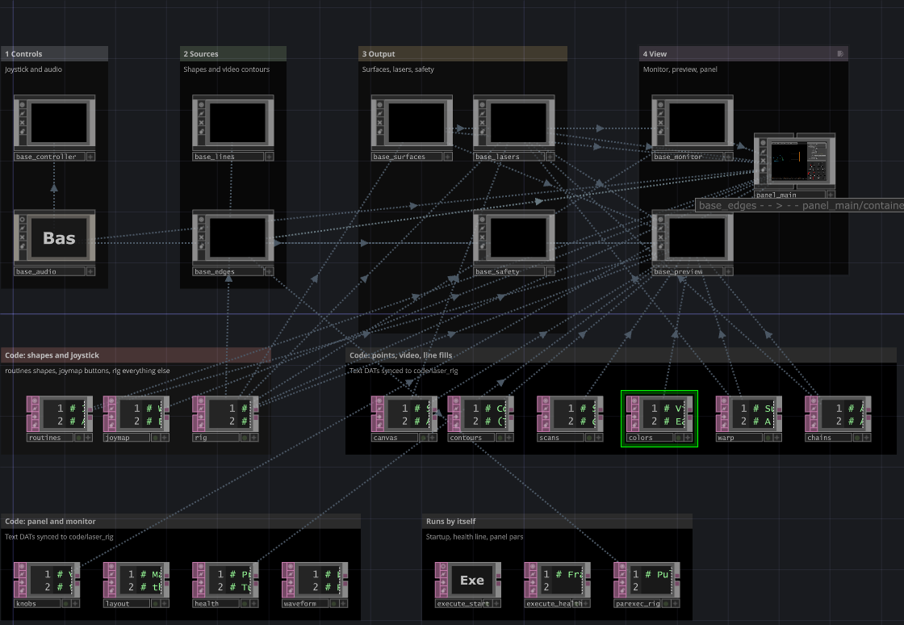

# TouchLaser

A free laser rig for TouchDesigner: draw on the laser from video, shapes and hand-drawn lines, and play it live with a game controller. It replaced MadMapper for our laser shows.



## Where it started

Halloween 2026, a pool at La California in Moncalieri. Absurd place. The water was rotten green, as it should be on Halloween. 3 smoke machines, a steaming pool, one big laser and a joystick for anyone who walked past.

This is the exact version that ran that night. Thanks to [Mike KabX](https://www.instagram.com/mike_kabx/), [Projekt X](https://www.instagram.com/projektx_torino/), [Pixels Smoothies](https://www.instagram.com/pixels_smoothies/) and [kep_w00w](https://www.instagram.com/kep_w00w/).

| | | |
|---|---|---|
|  |  |  |

## Quick start

1. Install [TouchDesigner](https://derivative.ca/download). Built and run on build **2025.32460**.
2. Download this repo and keep the folder together: `TouchLaser.toe` loads its scripts from `code/laser_rig/`.
3. Open `TouchLaser.toe`, go to `/project1/laser_rig`, right-click `panel_main` and choose View.

You can play with everything in the preview without a laser. The rig always opens safe: E-stop on, Arm off, one laser at 30%, a white grid.

### Connect a laser

1. Set the laser's **Device Type**, then pick it in **Device**. Supported types are ShowNET, Helios and EtherDream. For Helios, press **Scan** on `laserN/laserdevice_out` first.
2. Turn E-stop off, then **Arm Laser Output**, then **Enable Device Output** on that laser.
3. Start with **Test Pattern** on and low Power. Aim the whole scan area before you add content.

Loading a setup never turns Enable on.

Only real output tested so far: Laserworld DS-2000RGB MK2 over ShowNET at 30 to 45 kpps. Helios and EtherDream are in the menu but untested here. Laser output on the free Non-Commercial licence is also untested.

## Safety

This software steers a real laser. **Keep every beam above the audience, or terminate it on a safe surface.** Software limits are not a safety system: use a hardware interlock and E-stop, and follow your local laws and a proper risk assessment. Points concentrate the power on far less line, so turn Power down for them. Never run an unattended public joystick without zones and masking set on the projector. You use this at your own risk.

## What you can do

- **+ Laser**: each laser is a rectangle on a shared canvas, with its own colour balance, scan rate and step size.
- **+ Surface**: a rectangle or tilted plane of content: joystick shapes, Spout or NDI video traced into lines, or a test pattern. One surface can span several lasers.
- **+ Line**: draw a line point by point with corners and curves, then fill it with a mask, hatch, rings, or content bent along it.
- **11 beam patterns made for haze**: Cone, Cones, Tunnel, Vortex, Fan, Scissors, Sheets, Wave, Liquid Sky, Curtain, Knot. A ring is a cone in the air, a line is a sheet.
- **Video contours**: the picture becomes laser lines, with line, engraver, radar and iris scans on the D-pad.
- **Audio reactive**: low pumps size, mid moves and rotates, high bends the form, the loudest band dims.
- **Save and Load**: setups live in `profiles/`. The included `laser_rig.json` is the Halloween layout with no device selected.

## Controller

An Xbox-style pad. Every button does one thing, so you never scroll a list in the dark. The mode switch is on the panel (**Joystick Controls**).

| Control | Shape mode | Video mode |
|---|---|---|
| X / B / A | blue / red / green, they mix like light | same |
| Y | blackout | same |
| L1 | lines or points | same |
| D-pad | left, right: shape. Up, down: variant | one scan per arrow, same arrow stops it |
| L2 / R1 / R2 | noise level 1 / 2 / 3 | L2 white strobe, R1 hold, R2 dim |
| Left stick | turn the shape | softness / black floor |
| Right stick | Y camera zoom, X rotate | X shift contours, Y scan by hand or drift |
| L3 / R3 | reset shape / reset camera | reset video / reset camera |
| View | tempo x1 to x4 | same |
| Menu | tap audio on or off, hold for second layer | same |

The full map is `base_controller/README_buttons` inside the project, and the buttons are defined in `code/laser_rig/joymap.py`.

## How it works



The network reads left to right: controls, sources, output, view, with the code underneath.

```
base_controller  pad -> speed and count CHOPs -> null_controls
base_audio       mic or ASIO -> 3 auto-gained bands -> noise -> null_audio
base_lines       joystick shapes, built by routines.py
base_edges       Spout | NDI | test -> blur, contrast, bands on the GPU
base_surfaces    surfaceN and lineN: settings only
base_lasers      laserN: script_laser -> Laser CHOP -> Laser Device
base_safety      Arm, E-stop, master limit, blackout, strobe, dim
base_monitor     private copy of the laser signal for the waveform
base_preview     what each laser really outputs
panel_main       toolbar, view, settings panels
```

**The main design rule: laser points stay on the CPU in numpy.** The Laser CHOP is a CPU signal. Reading points back from a POP cost about 17 ms of waiting per frame on our laptop (GTX 1070), so the GPU does only image work and preview. The rig uses no POPs or SOPs for laser points, and even the Trace SOP was replaced.

The path of one point:

1. **Source.** `routines.py` turns the controls into shapes, or `base_edges` makes a black and white band image on the GPU. `contours.py` reads that image back and follows its edges with OpenCV.
2. **Canvas.** `canvas.py` passes around one simple shape: N x 2 positions, N x 3 colours, corner flags and stroke ids. It applies the camera (`view`), splits long strokes (`divide`) and turns lines into points (`points`).
3. **Surface.** `warp.py` blends the four corners. `chains.py` uses a drawn line as geometry for other content.
4. **Laser.** `script_laser` keeps what falls inside the laser's rectangle and maps it to the scan area (`canvas.pack`). The rectangle is the laser's full scan.
5. **Output.** The Laser CHOP adds blanking and timing. `base_safety` gates it, and a guard cuts RGB if the scan span drops under 0.1, which means a stopped beam.

A few things worth stealing:

- **Step Size is corrected.** We measured the Laser CHOP's real step per sample at about `stepsize * 187500 / rate` on this build. `laser_out` compensates, so **Step Size** means real distance at any scan rate. Big steps make scanners loud: 0.02 with Blanking 3 at 30 kpps stopped the motor noise on ours.
- **Don't enable Frame Start Pulse on the live Laser CHOP.** It inserts a sample with all colours at -1. `base_monitor` runs a private copy to get those pulses safely.
- **Scan budget.** A dense variant shrinks rather than flickers (`BUDGET` in `routines.py`).
- **One shader for the knobs.** The Video Knobs panel is drawn by `knobs.glsl` from a small data image and redraws only when a value moves.
- **Health line.** `health.py` turns frame times and memory into OK, WATCH, SLOW or DANGER, once a second.

### Code map

| File | What it does |
|---|---|
| `rig.py` | The manager: add and delete, mouse, overlay, save and load |
| `routines.py` | Beam patterns and noise levels |
| `joymap.py` | Every button and stick |
| `canvas.py` | Shape format, camera, points, warp, mapping to a laser |
| `chains.py` | Line fills |
| `contours.py`, `colors.py` | Edges from the band image, colour from the video |
| `scans.py`, `contour_bands.glsl` | Video scans |
| `warp.py` | Surface warp and its limits |
| `waveform.py` | Laser monitor |
| `health.py`, `layout.py`, `knobs.py` | Health line, panel layout, knobs |

Scripts in the project are Text DATs synced to these files, so edit them in any editor. Modules without TD calls have tests that run in plain Python with numpy and OpenCV, one file at a time:

```
python code/laser_rig/tests/test_canvas.py
```

## Known limits

- Random "scratched old film" artifacts appeared on our projector in rehearsal. The signal log was clean, so the cause looks like the hardware path, but it isn't proven.
- Windows only as tested. Spout is Windows only.
- The physical pad layout was first used in public at this show. Expect rough edges.

## How it was made

Built in TouchDesigner by talking to Claude (Anthropic) through an MCP server, with me steering, testing and playing it. The MCP bridge is removed from this release: the file is plain TouchDesigner.

## License

[MIT](LICENSE): use it, change it, use it in paid gigs. A tag is appreciated: [@zen_for_tv](https://www.instagram.com/zen_for_tv/).
